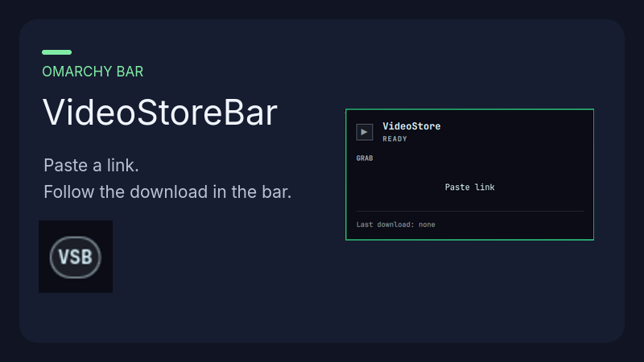
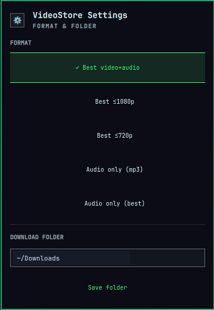

# VideoStoreBar

Download a video or extract audio from a clipboard link without leaving the Omarchy bar. Open the **VSB** badge, choose **Paste link**, and watch progress in the bar. Open the flyout again to cancel a running download.



## Install

Requires Omarchy 4.x with Quickshell, Python 3.10 or later on Linux, `yt-dlp`, `wl-paste` from `wl-clipboard`, and `ffmpeg` for merging and converting media. The VideoStore engine ships with the widget and uses its own yt-dlp options.

```sh
omarchy plugin add https://github.com/CallMeBakugo/VideoStoreBar.git --enable
```

## Use

- **Left-click** to open Paste or Cancel. Paste reads one HTTP or HTTPS URL, up to 8 KiB, from your clipboard. Playlist links are skipped. Choose a link to an individual video.
- **Right-click** for format and download-folder settings. Pick best quality, cap the resolution at 1080p or 720p, or choose audio only.
- Downloads default to `~/Downloads`. The widget runs one download at a time and keeps the last result locally, without storing URL or filename history in its own state.



## Remove

Cancel any active download from the widget, then remove it:

```sh
omarchy plugin remove bakugo.videostorebar --yes
```

The widget's settings and last result live in `${XDG_STATE_HOME:-$HOME/.local/state}/videostorebar`. Downloads stay in the folder you chose.

[MIT license](LICENSE).
