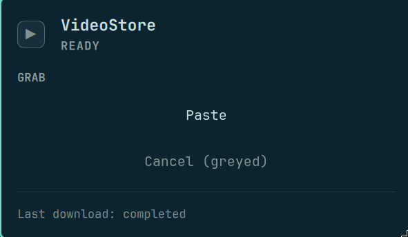
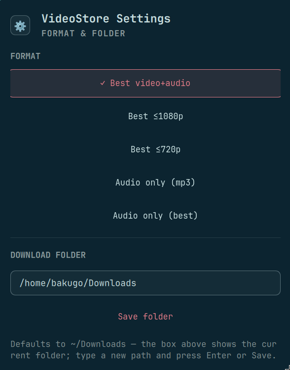

# VideoStoreBar

Omarchy bar-widget companion to [VideoStore](https://github.com/CallMeBakugo/VideoStore):
a VSB chip on your bar that downloads whatever link is in your clipboard.
Left-click: Paste. Right-click: settings (format + download folder, the
current choice highlighted with a checkmark). While a download runs, the
chip becomes a progress bar and Paste greys out in favour of Cancel.
No history, no memory — last-download status only, never a filename.

## Install

    omarchy plugin clone CallMeBakugo/VideoStoreBar
    omarchy bar put bakugo.videostorebar --section right --after omarchy.tray
    install -Dm755 vsb-daemon ~/.local/bin/vsb-daemon

The daemon needs the `core.py` engine from
[VideoStore](https://github.com/CallMeBakugo/VideoStore) on its import
path (edit the `sys.path` line in `vsb-daemon` if you keep that repo
elsewhere), plus `yt-dlp`, `wl-paste` (clipboard), and Python 3.

## Pieces

- `Panel.qml` + `manifest.json` — the Omarchy bar-widget plugin
  (Quickshell/QML). Chip states: idle (VSB), downloading (fill bar),
  hover tooltip with last-download status only — never a filename.
- `vsb-daemon` — forked download runner. One download at a time
  (lockfile), atomic JSON state that the widget watches reactively,
  cancel via SIGTERM. Settings persist in
  `~/.local/state/videostorebar/settings.json`; folder paths are
  normalised to absolute and the download anchors to $HOME.

## Settings

Right-click the chip: pick the format (highlighted with a checkmark
when active) and type the download folder in the box (defaults to
~/Downloads, created if missing). Or from the terminal:

    vsb-daemon set format=label_1080
    vsb-daemon set outdir=~/Videos